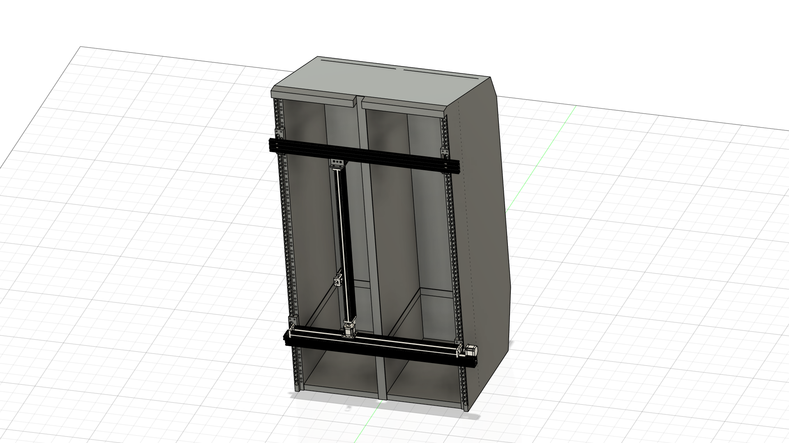

# SimofRack_onlylinear — Robot Description



## Overview

| Property | Value |
|----------|-------|
| Total mass | 3600.332 kg |
| Links | 8 |
| Joints | 7 (4 movable) |
| Assemblies | 6 |
| Root link | `base_link` |

## Table of Contents

- [Kinematic Tree](#kinematic-tree)
- [Link Properties](#link-properties)
- [Joint Properties](#joint-properties)
- [Assembly Breakdown](#assembly-breakdown)
- [Quick Start (ROS 2)](#quick-start-ros-2)
- [Files](#files)

## Kinematic Tree

```
base_link [BAKE]
  └─ Top_Slider [prismatic]
    Top_support
  └─ Xslider18_Raack [fixed]
    Linear_Actuator_X_edited_Component18
      └─ Slider_2 [prismatic]
        Linear_Actuator_X_edited_Component1 [BAKE]
          └─ Xplate_Ymotor [fixed]
            Linear_Actuator_Y_Component18
      └─ Slider_2_1 [prismatic]
        Linear_Actuator_Y_Component1 [BAKE]
          └─ Rigid_52 [fixed]
            Component6
              └─ Slider_3 [prismatic]
                Component7 [BAKE]
```

## Link Properties

| Link | Mass (kg) | Material | Collision | Bodies |
|------|-----------|----------|-----------|--------|
| `Component6` | 1.1523 | Steel | box | 1 |
| `Component7` | 0.2577 | Steel | box | 1 |
| `Linear_Actuator_X_edited_Component1` | 0.3461 | Steel | cylinder | 2 |
| `Linear_Actuator_X_edited_Component18` | 8.7912 | Steel | box | 1 |
| `Linear_Actuator_Y_Component1` | 0.3461 | Steel | cylinder | 2 |
| `Linear_Actuator_Y_Component18` | 8.7912 | Steel | box | 1 |
| `Top_support` | 1.1870 | Steel | box | 19 |
| `base_link` | 3579.4602 | Steel | box | 5 |

## Joint Properties

| Joint | Type | Parent → Child | Axis | Limits |
|-------|------|---------------|------|--------|
| `Rigid_52` | fixed | `Linear_Actuator_Y_Component1` → `Component6` | (0,0,1) | — |
| `Slider_2` | prismatic | `Linear_Actuator_X_edited_Component18` → `Linear_Actuator_X_edited_Component1` | (-1,0,0) | [-875.0, 10.0] mm |
| `Slider_2_1` | prismatic | `Linear_Actuator_X_edited_Component18` → `Linear_Actuator_Y_Component1` | (1,0,0) | [-850.0, -10.0] mm |
| `Slider_3` | prismatic | `Component6` → `Component7` | (-1,0,0) | [10.0, 75.0] mm |
| `Top_Slider` | prismatic | `base_link` → `Top_support` | (0,-1,0) | — |
| `Xplate_Ymotor` | fixed | `Linear_Actuator_X_edited_Component1` → `Linear_Actuator_Y_Component18` | (0,0,1) | — |
| `Xslider18_Raack` | fixed | `base_link` → `Linear_Actuator_X_edited_Component18` | (0,0,1) | — |

## Assembly Breakdown

### KK50_150

- **Links**: Component6
- **Total mass**: 1.152 kg

### KK50_A1

- **Links**: Component7
- **Total mass**: 0.258 kg

### Linear_Act_Z

- **Links**: 
- **Total mass**: 0.000 kg

### Linear_Actuator_X_edited

- **Links**: Linear_Actuator_X_edited_Component1, Linear_Actuator_X_edited_Component18
- **Total mass**: 9.137 kg

### Linear_Actuator_Y

- **Links**: Linear_Actuator_Y_Component1, Linear_Actuator_Y_Component18
- **Total mass**: 9.137 kg

### SimofRack_onlylinear

- **Links**: base_link, Top_support
- **Total mass**: 3580.647 kg

## Quick Start (ROS 2)

```bash
# 1. Copy package to your ROS 2 workspace
cp -r SimofRack_onlylinear_description ~/ros2_ws/src/

# 2. Build
cd ~/ros2_ws
colcon build --packages-select SimofRack_onlylinear_description
source install/setup.bash

# 3. Visualize in RViz2
ros2 launch SimofRack_onlylinear_description display.launch.py

# 4. Validate URDF structure
check_urdf install/SimofRack_onlylinear_description/share/SimofRack_onlylinear_description/urdf/SimofRack_onlylinear.urdf

# 5. Print kinematic tree
urdf_to_graphviz install/SimofRack_onlylinear_description/share/SimofRack_onlylinear_description/urdf/SimofRack_onlylinear.urdf
```

**Joint control**: The launch file includes `joint_state_publisher_gui` —
use the sliders to move revolute/prismatic joints in RViz2.

**Topic inspection**:
```bash
# See published joint states
ros2 topic echo /joint_states

# See robot description parameter
ros2 param get /robot_state_publisher robot_description
```

## Files

| Path | Description |
|------|-------------|
| `urdf/SimofRack_onlylinear.urdf.xacro` | Top-level xacro (entry point) |
| `urdf/SimofRack_onlylinear.urdf` | Flat URDF (for validation) |
| `urdf/assemblies/` | Per-assembly xacro macros |
| `meshes/` | Visual (OBJ) and collision (STL) meshes |
| `launch/display.launch.py` | Launch robot_state_publisher, RViz, and generated controllers |
| `config/joint_state.yaml` | Joint state publisher config |
| `config/ros2_controllers.yaml` | Generated ros2_control controller manager config |
| `robot_data.yaml` | Supplementary data (beyond URDF) |
| `docs/transforms.md` | Transformation matrices (KaTeX) |

## Customizing

Assemblies tagged `!dummy_` are designed to be swapped out. To replace one:

1. Create your replacement as a xacro macro with the same interface
2. Place it in `urdf/assemblies/`
3. Update the `<xacro:include>` in `urdf/SimofRack_onlylinear.urdf.xacro`
4. Update meshes in `meshes/<your_assembly>/`

The xacro prefix system (`${prefix}`) ensures link names stay unique
when multiple instances of the same assembly are used.

---
*Generated by Fusion URDF/XACRO Exporter v3.1.1*